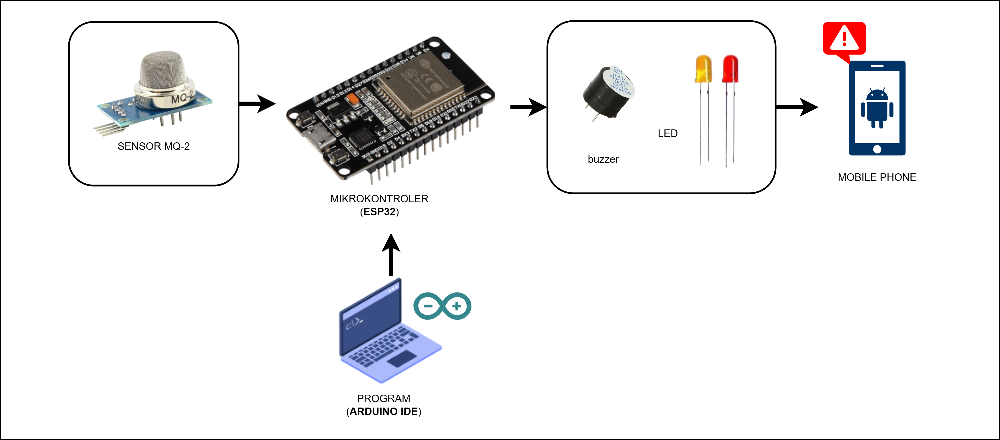
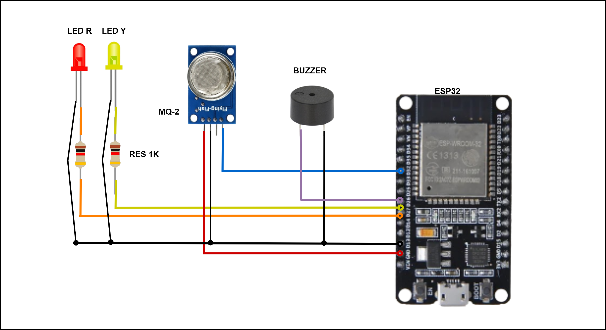
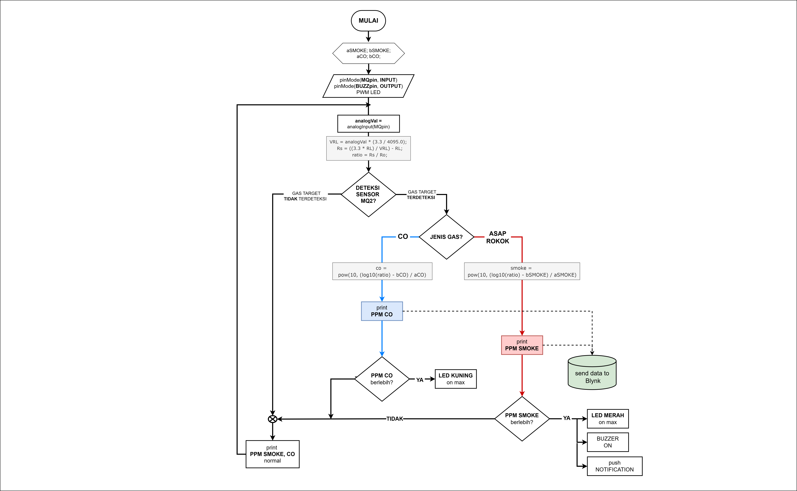
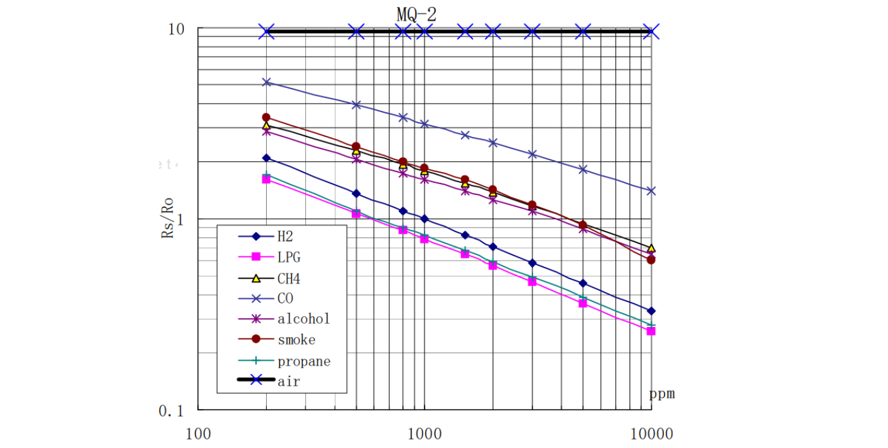

# Sistem Pemantau dan Peringatan Asap Rokok Berbasis ESP32

Sistem pemantau kualitas udara sederhana yang mendeteksi **asap rokok** dan **gas karbon monoksida (CO)** menggunakan sensor **MQ-2** dan mikrokontroler **ESP32**. Konsentrasi gas (ppm) dipantau secara *real-time* melalui platform **Blynk**, ditunjukkan dengan kecerahan **LED** (kuning untuk CO, merah untuk asap rokok), dan disertai **buzzer** serta **notifikasi ke ponsel** ketika asap rokok berlebih.

## Arsitektur Sistem



## Komponen

| Komponen | Jumlah | Spesifikasi ringkas |
|---|---|---|
| ESP32 Development Board | 1 | Tegangan kerja 2,2–3,6 V, regulator *on-board* 3,3 V 600 mA, Wi-Fi dan Bluetooth |
| Sensor gas MQ-2 | 1 | Tipe semikonduktor; target gas mudah terbakar dan asap rokok; rentang deteksi 300–10000 ppm; VC dan VH 5 V; konsumsi pemanas ≤ 950 mW |
| LED merah | 1 | VF 1,8 V; panjang gelombang 630–660 nm |
| LED kuning | 1 | VF 2,2 V; panjang gelombang 585–595 nm |
| Resistor 1000 Ω | 2 | Pembatas arus LED (arus LED yang disarankan 16–18 mA) |
| *Active buzzer* | 1 | Tegangan kerja 4–8 V DC, arus ≤ 30 mA, ≥ 85 dB pada 10 cm |
| Sumber tegangan AC eksternal | 1 | Suplai daya rangkaian |
| Ponsel dengan aplikasi Blynk | 1 | Pemantauan dan notifikasi |

## Interkoneksi Sistem



| Komponen | Pin komponen | Pin ESP32 | Catatan |
|---|---|---|---|
| Sensor MQ-2 | A0 | **GPIO 35** | Masukan analog (ADC1) |
| LED merah | Anode (+) | **GPIO 14** | Melalui resistor 1000 Ω |
| LED kuning | Anode (+) | **GPIO 27** | Melalui resistor 1000 Ω |
| Buzzer | Anode (+) | **GPIO 26** | Kaki katode ke GND |

## Cara Kerja



### 1. Inisialisasi

Setelah sistem menyala, ESP32 menginisialisasi seluruh komponen:

- Sensor MQ-2 diatur sebagai `INPUT`.
- LED merah, LED kuning, dan buzzer diatur sebagai `OUTPUT`. LED memakai **PWM** (5 kHz, resolusi 8-bit, kanal 0 untuk merah dan kanal 1 untuk kuning) untuk mengatur intensitas nyala.
- Koneksi **WiFi** dan **Blynk** dibangun.

### 2. Pembacaan dan Perhitungan

Setiap **200 ms**, ESP32:

1. Membaca nilai ADC sensor dan mengonversinya menjadi tegangan **VRL**.
2. Menghitung resistansi sensor **Rs** dan rasio **Rs/Ro** (Ro = resistansi sensor di udara bersih).
3. Menghitung konsentrasi **CO** dan **asap rokok** dalam ppm dari persamaan logaritmik berdasarkan kurva sensitivitas MQ-2.
4. Mengirim nilai ke Blynk (V0 untuk CO, V1 untuk asap rokok).

### 3. Keluaran

| Kondisi | Keluaran |
|---|---|
| Konsentrasi CO meningkat | LED **kuning** makin terang (PWM 0–255 untuk 0–3000 ppm) |
| Konsentrasi asap rokok meningkat | LED **merah** makin terang (PWM 0–255 untuk 0–3000 ppm) |
| Asap rokok **> 500 ppm** | **Buzzer** berbunyi 3 kali, dan notifikasi dikirim ke ponsel melalui otomasi Blynk |

## Dasar Perhitungan

**Tegangan beban (VRL)**, persamaan [1]

$$
V_{RL} = analogVal × \frac{3.3}{4095.0}
$$

**Resistansi sensor (Rs)**, persamaan [2]

$$
Rs = (3.3 \times \frac{RL}{VRL}) − RL
$$

**Rasio terhadap udara bersih**, persamaan [3]

$$
ratio = \frac{Rs}{Ro}
$$

**Konsentrasi gas (ppm)**, persamaan [4]



Kurva sensitivitas MQ-2 pada datasheet berbentuk garis lurus pada skala log-log, sehingga:

$$
\text{gas target} = 10 ^ {(\frac{\log_{10}(ratio) − \log_{10}(b_{\text{gas target}})}{a_{\text{gas target}}})}
$$

Konstanta `a` dan `b` diperoleh dari regresi logaritmik dua titik pada kurva datasheet, yaitu (x₁, y₁) dan (x₂, y₂), persamaan [5] dan [6]:

$$
a = \frac{\log_{10}(y₂) − \log_{10}(y₁)}{\log_{10}(x₂) − \log_{10}(x₁)}
$$

$$
\log_{10}(b) = \log_{10}(y) − a × \log_{10}(x)
$$

Konstanta yang digunakan pada program (lihat [Kurva Sensitivitas Gas MQ-2](LAMPIRAN/sensitivity-gas-curve-MQ2.png)):

| Gas | a | log10(b) |
|---|---|---|
| Asap rokok (smoke) | −0.380125 | 3.239386 |
| CO | −0.310404 | 3.296899 |

## Panduan Penggunaan

### Prasyarat

- Arduino IDE dengan dukungan board **ESP32**
- Library **Blynk** (`BlynkSimpleEsp32`)
- Akun dan aplikasi **Blynk** pada ponsel

### Langkah 1️⃣: Kalibrasi sensor (`MQ2_calibration.ino`)

1. Hubungkan rangkaian dan **panaskan (pre-heat) sensor MQ-2** di **udara bersih**. Datasheet menyarankan lebih dari 24 jam, dan pada pengujian proyek ini, memperpanjang durasi pre-heating membuat pembacaan menjadi stabil.
2. Sesuaikan pin MQ-2 (`MQpin`) dan resistansi beban `RL` (dalam kΩ).
3. Upload program, lalu buka Serial Monitor dengan baud rate **9600**.
4. Program menampilkan `Analog-Value`, `ADC v1`, `ADC v2`, `VRL`, `Rs`, dan `Ro udara bersih`:
   - `ADC v1` (`analogReadMilliVolts()`) dan `ADC v2` (fungsi `ReadVoltage()` terkalibrasi) hanya pembanding. Pada pengujian keduanya jauh berbeda dari `VRL`, sehingga tegangan tetap diambil dari **VRL**.
   - Nilai pembagi `9.5316...` pada perhitungan Ro adalah rasio Rs/Ro di udara bersih menurut garis `air` pada kurva sensitivitas datasheet.
5. Catat nilai **Ro** yang stabil.

> Jika `Ro` bernilai `inf` atau berfluktuasi, periksa kabel jumper dan breadboard.

### Langkah 2️⃣: Pemantauan (`MQ2_monitoring.ino`)

1. Isi kredensial pada bagian atas program:

   ```cpp
   #define BLYNK_TEMPLATE_ID   "..."
   #define BLYNK_TEMPLATE_NAME "..."
   #define BLYNK_AUTH_TOKEN    "..."

   char ssid[] = "...";   // nama jaringan WiFi
   char pass[] = "...";   // kata sandi WiFi
   ```

2. Masukkan nilai **Ro** hasil kalibrasi pada `#define Ro`. Gunakan nilai dari kalibrasi sensor Anda sendiri.
3. Upload program ke ESP32, lalu buka Serial Monitor dengan baud rate **115200** untuk melihat nilai `SMOKE` dan `CO` dalam ppm.

## Konfigurasi Blynk

1. Buat **Template** baru, lalu salin Template ID, Template Name, dan Auth Token ke program.
2. Tambahkan **Datastream** (tipe *Double*):

   | Virtual Pin | Data |
   |---|---|
   | V0 | Konsentrasi CO (ppm) |
   | V1 | Konsentrasi asap rokok (ppm) |

3. Tambahkan widget (misalnya *Gauge* dan *Chart*) pada dashboard web dan aplikasi ponsel. Pada proyek ini, rentang gauge yang dipakai adalah 0–5000 ppm.
4. Buat **Otomasi (Automation)** untuk mengirim notifikasi ke ponsel ketika **V1** melebihi 500 ppm. Pada pengujian, pesan notifikasi berbunyi `SMOKE DETECTED`.

## Parameter yang Dapat Disesuaikan

| Parameter | Lokasi | Nilai saat ini | Keterangan |
|---|---|---|---|
| `MQpin` | Kedua program | `35` | Pin ADC sensor MQ-2 |
| `RL` | Kedua program | `1` kΩ | Resistansi beban modul MQ-2 |
| `Ro` | Program pemantauan | `2.5` | Hasil kalibrasi udara bersih |
| Ambang buzzer dan notifikasi | `if(smoke > 500)` | `500` ppm | Batas asap rokok berlebih |
| Rentang PWM LED | `map(..., 0, 3000, 0, 255)` | 0–3000 ppm | Konsentrasi untuk kecerahan maksimum |
| Interval pembacaan | `timer.setInterval` | `200` ms | Periode pembacaan sensor |

## Hasil Pengujian

### Kalibrasi Ro (udara bersih)

Pada 20 sampel pembacaan Program 1 (ESP32), nilai analog berada pada kisaran **100–300**. Mayoritas sampel menghasilkan Ro sekitar **2,0–2,1 kΩ**, dengan beberapa pencilan (misalnya 2,74 dan 1,57) akibat fluktuasi pembacaan.

| Analog Value | VRL (V) | Rs (kΩ) | Ro (kΩ) |
|---|---|---|---|
| 193 | 0,16 | 20,22 | 2,12 |
| 198 | 0,16 | 19,68 | 2,06 |
| 201 | 0,16 | 19,37 | 2,03 |
| 203 | 0,16 | 19,17 | 2,01 |
| 204 | 0,16 | 19,07 | 2,00 |

Dari hasil ini, **Ro ≈ 2 kΩ** dipakai sebagai acuan untuk Program 2.

### Uji konsentrasi gas target (Program 2)

Pengujian dilakukan dengan mendekatkan asap rokok ke sensor.

| Kondisi | Analog Value | SMOKE (ppm) | CO (ppm) |
|---|---|---|---|
| Aman (udara bersih) | 130–194 | 4,39–12,66 | 5,40–21,97 |
| Ada trigger asap konsentrasi rendah | 234–476 | 20,93–149,81 | 42,76–580,99 |
| Asap mulai menyebar | 511–589 | 183,88–278,95 | 762,33–1324,54 |

Dari uji ini, konsentrasi asap rokok dapat melonjak hingga lebih dari 100 ppm dan CO lebih dari 300 ppm. Berdasarkan hasil tersebut ditetapkan:

- rentang konsentrasi untuk PWM LED: **0–3000 ppm**,
- ambang pemicu buzzer dan notifikasi Blynk: **500 ppm**.

### Pemantauan Blynk

Data konsentrasi terkirim ke Blynk dan ditampilkan pada dashboard web dan aplikasi ponsel (gauge dan grafik tren). Notifikasi *pop-up* dan *in-app* berisi pesan `SMOKE DETECTED` diterima di ponsel ketika ambang batas terlampaui. Pemantauan dilakukan selama beberapa hari untuk melihat tren polusi asap di sekitar lokasi perangkat.

## Kendala dan Evaluasi

- **Sensor MQ-2 sulit dikalibrasi.** Pembacaan Ro sering tidak valid (`inf`) atau fluktuatif, terutama bila kabel jumper atau breadboard tersenggol. Pembacaan awal dengan Arduino UNO R3 terbaca tetapi tidak sesuai kondisi lingkungan normal. Setelah pre-heating diperpanjang, nilai analog pada ESP32 stabil di kisaran 100–200.
- **Hubung pendek pada ESP32.** Saat upload program terjadi reset berulang (*overflow load sketch*), lalu terjadi *short circuit* pada chip ESP32 yang memanas dalam waktu kurang dari 10 detik. Masalah diatasi dengan mengganti ESP32 dan menjaga posisi rangkaian tetap selama pre-proses maupun proses utama.
- **Akurasi terbatas.** MQ-2 hanya memberi perkiraan tren konsentrasi gas, bukan nilai yang akurat dan spesifik untuk satu jenis gas [7].

## Referensi

1. Last Minute Engineers, "Getting Started With ESP32: A Beginner's Guide," 25 Jan 2023. https://lastminuteengineers.com/getting-started-with-esp32/
2. Datasheet sensor MQ-2.
3. Pro-SIGNAL, "Buzzer – datasheet V1.0," 2 Nov 2016. https://www.farnell.com/datasheets/2171929.pdf
4. M. Shahid, "Light Emitting Diode," Electronics-Lab.com, 7 Jun 2021. https://www.electronics-lab.com/article/light-emitting-diode/
5. D. Dhakne, "MQ2 Gas Sensor Tutorial: Measuring Gas Concentration with PictoBlox," STEMpedia Education, 28 Apr 2023. https://ai.thestempedia.com/docs/evive-iot-kit/interfacing-mq-2-gas-sensor-with-evive/
